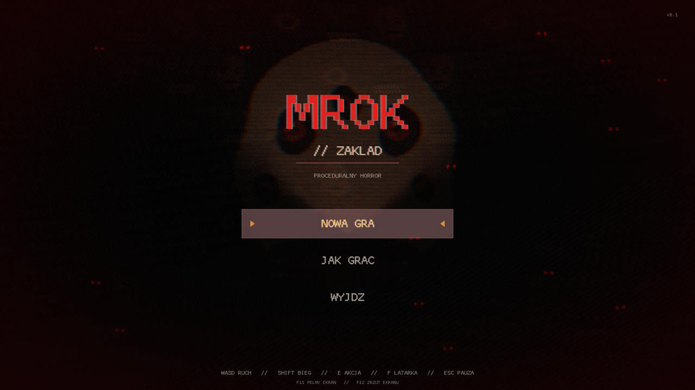
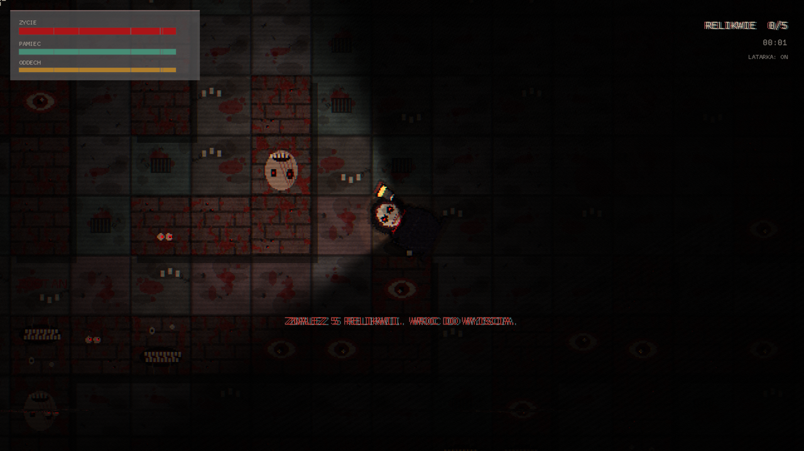

# MROK // ZAKLAD

> Proceduralny horror top-down napisany w Rust. Wszystko — tekstury, dźwięk, mapa, potwory — powstaje w kodzie. Zero assetów, zero internetu, zero litości.




## O grze

**MROK // ZAKLAD** to survival horror z widokiem z góry. Budzisz się w zakładzie, który nie istnieje na żadnej mapie. Musisz znaleźć **5 relikwii** i wrócić do wyjścia, zanim twoja **pamięć** (sanity) spadnie do zera.

Świat jest generowany proceduralnie przy każdym uruchomieniu — labirynt, pokoje, rozkład relikwii, potwory i wszystkie tekstury. Nie ma dwóch takich samych przejść.

### Mechaniki

| System | Opis |
| --- | --- |
| **Życie** | Czerwony pasek. Potwory zabierają HP kontaktem; przy zerowym sanity tracisz zdrowie w tle. |
| **Pamięć (sanity)** | Spada w ciemności i blisko potworów, rośnie przy relikwiach. Poniżej 20% obraz zaczyna pękać, poniżej 12% w HUD pojawia się twarz. |
| **Oddech** | Bieg (Shift) zużywa oddech; bez niego możesz tylko iść. |
| **Latarka** | Stożek światła (F). Widzisz tylko to, co oświetlisz — one widzą wszystko. |
| **Relikwie** | 5 przedmiotów rozrzuconych po labiryncie. Każda dodaje +28 pamięci i +8 życia. |
| **Wyjście** | Zablokowane do zebrania wszystkich relikwii. |
| **Potwory** | 3 typy, patrolują i ścigają gracza po ścieżkach BFS. Reagują na światło i hałas. |
| **Halucynacje** | Przy niskim sanity pojawiają się fałszywe zjawy i szepty. |

### Oprawa

- Render do niskorozdzielczego bufora **640×360** i skalowanie do pełnego okna — ostry, pixel-artowy look.
- Własny shader GLSL: stożek latarki, aberracja chromatyczna, glitch, ziarno, scanlines, winieta, odkształcenia od sanity.
- Proceduralne tekstury: ściany z twarzami, oczami i paszczami, podłogi z plamami, sprite'y gracza i potworów.
- Proceduralny dźwięk: ambient, kroki, szepty, bicie serca, trafienia — syntezowane do WAV w pamięci.
- Animowane menu z twarzą, glitchujący tekst i ekrany śmierci/zwycięstwa.

## Sterowanie

| Klawisz | Akcja |
| --- | --- |
| `WASD` / strzałki | Ruch |
| `SHIFT` | Bieg (zużywa oddech) |
| `F` | Latarka on/off |
| `E` | Podnieś relikwię / użyj wyjścia |
| `ESC` | Pauza |
| `F11` | Pełny ekran |
| `F12` | Zrzut ekranu (`mrok_<czas>.png`) |

## Uruchomienie

### macOS

Wymagania: Rust (stable) oraz Xcode Command Line Tools.

```bash
git clone <repo> && cd mrok
cargo run --release
```

Gotową aplikację `.app` zbudujesz skryptem:

```bash
./scripts/package-macos.sh
# wynik: dist/MROK.app
```

### Windows 11

Wymagania: Rust (stable) z toolchainem MSVC oraz Visual Studio Build Tools (C++).

```powershell
git clone <repo>; cd mrok
cargo run --release
```

Paczkę ZIP zbudujesz w PowerShell:

```powershell
.\scripts\package-windows.ps1
# wynik: dist\mrok-windows-x86_64.zip
```

### Cross-compile Windows z Linuksa/macOS (opcjonalnie)

```bash
cargo install cargo-xwin
rustup target add x86_64-pc-windows-msvc
cargo xwin build --release --target x86_64-pc-windows-msvc
```

## Optymalizacja

Profil wydania w `Cargo.toml`:

```toml
[profile.release]
opt-level = 3
lto = "fat"
codegen-units = 1
panic = "abort"
strip = "symbols"
debug = false
incremental = false
```

Dlaczego to działa (na podstawie dokumentacji Cargo i praktyki):

- **`lto = "fat"` + `codegen-units = 1`** — cały program optymalizowany jako jedna jednostka; eliminuje narzut na granicach crates i odblokowuje agresywniejszy inline. Koszt: dłuższa kompilacja.
- **`panic = "abort"`** — brak mechanizmu unwindowania; mniejszy binarny plik i szybszy kod w ścieżkach błędów.
- **`strip = "symbols"`** — usuwa symbole debugowe z wydania (mniejszy plik).
- **`opt-level = 1` dla dev, `2` dla zależności** — szybki dev-loop bez tracenia grywalnego FPS; ciężkie crates (macroquad, image) kompilują się zoptymalizowane.

Optymalizacje w kodzie:

- **Niski render target 640×360** — cała scena rysowana w ~230 tys. pikseli zamiast 920 tys. (720p) czy 2 mln (1080p); shader działa na małym buforze, skalowanie robi GPU.
- **`FilterMode::Nearest`** — brak interpolacji, ostry pixel-art i tańsze próbkowanie.
- **Throttling AI** — BFS potworów przeliczany co ~0.35 s, nie co klatkę; ścieżki cache'owane.
- **Dystansowe culling** — obiekty poza ekranem i daleko od gracza nie są rysowane/aktualizowane.
- **Brak I/O w pętli klatki** — wszystkie tekstury i dźwięki powstają raz przy starcie; gra nie dotyka dysku podczas rozgrywki.
- **Reużywane bufory** — cząstki, ścieżki BFS i wektory zdarzeń są przetwarzane bez ciągłego tworzenia nowych struktur.
- **Deterministyczny RNG** — tani hash zamiast zewnętrznych crate'ów; powtarzalne seedowanie do testów.
- **Renderowane tylko widoczne kafle** — pętla rysowania ogranicza się do zakresu kamery, nie do całej mapy.

## Struktura projektu

```
src/
  main.rs    — pętla gry, menu, stan ekranów, audio, render target
  game.rs    — rozgrywka: gracz, potwory, relikwie, AI, HUD, ekrany końca
  map.rs     — generacja labiryntu, kolizje, BFS, line-of-sight
  fx.rs      — shader post-processingu, scena menu, glitch tekstu
  assets.rs  — proceduralne tekstury (Canvas) i synteza dźwięku (WAV)
  rng.rs     — deterministyczny RNG, hash, value noise / FBM
scripts/
  package-macos.sh     — buduje dist/MROK.app
  package-windows.ps1  — buduje dist/mrok-windows-x86_64.zip
.github/workflows/
  release.yml          — CI: Windows x86_64 + macOS universal, release na tag
```

## Testy

```bash
cargo test
```

Testy sprawdzają:

- spójność labiryntu (każdy kafel osiągalny z każdego seeda),
- poprawność BFS i najdalszego kafla,
- kolizje gracza ze ścianami,
- umieszczenie relikwii, potworów, gracza i wyjścia na podłodze.

## CI i wydania

Workflow `.github/workflows/release.yml` buduje:

- `mrok-windows-x86_64.exe` na `windows-latest`,
- `mrok-macos-universal` (arm64 + x86_64, `lipo`) na `macos-latest`.

Push tagu `v*` tworzy GitHub Release z oboma artefaktami. Można też uruchomić ręcznie (`workflow_dispatch`).

## Tryby debugowe

Przydatne przy automatycznych zrzutach i testach:

| Zmienna | Działanie |
| --- | --- |
| `MROK_AUTOPLAY=1` | Pomija menu, od razu startuje grę. |
| `MROK_SCREEN=help\|pause\|dead\|win` | Wymusza dany ekran i zamraża logikę. |
| `MROK_SHOT_AT=<sek>` | Zapisuje `mrok_auto.png` po danym czasie. |
| `MROK_QUIT_AFTER=<sek>` | Kończy grę po danym czasie. |

Przykład:

```bash
MROK_AUTOPLAY=1 MROK_SHOT_AT=2.0 MROK_QUIT_AFTER=3.0 cargo run --release
```

## Rozwiązywanie problemów

**macOS: aplikacja nie chce się otworzyć.** Binarka jest podpisana ad-hoc, więc Gatekeeper może ją zablokować. Kliknij prawym przyciskiem → **Otwórz**, albo:

```bash
xattr -dr com.apple.quarantine dist/MROK.app
```

**macOS: crash przy starcie z `AudioQueueStart` / `assertion failed: res == 0`.** To panika biblioteki `quad-snd`, gdy CoreAudio nie może otworzyć kolejki audio (np. przy przełączaniu urządzenia wyjściowego). Upewnij się, że w System Settings → Sound wybrane jest działające wyjście, i uruchom grę ponownie.

**Windows: brak `VCRUNTIME140.dll`.** Zainstaluj [Visual C++ Redistributable](https://aka.ms/vs/17/release/vc-redist.x64.exe) (większość systemów już go ma).

**Za ciemno / nie widać nic.** To horror — stożek latarki to cała widoczność. Naciśnij `F`, żeby ją włączyć. Jasność monitora też pomaga.

## Licencja

MIT — szczegóły w [LICENSE](LICENSE).
